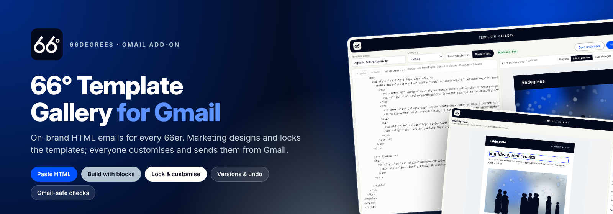
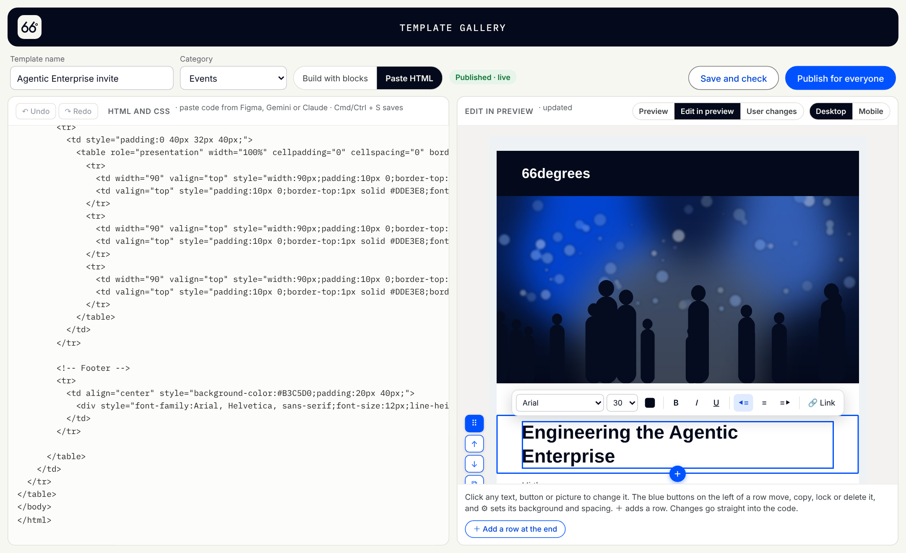
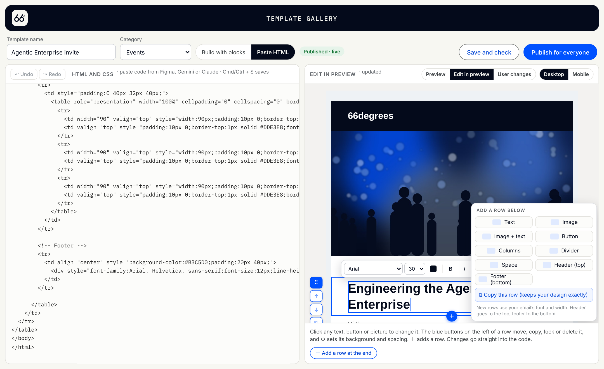
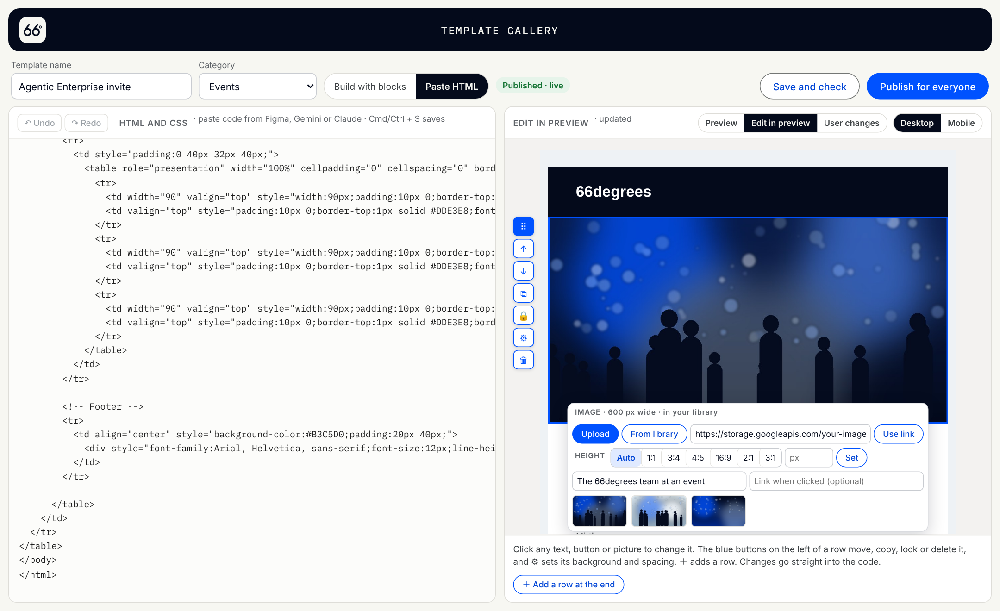
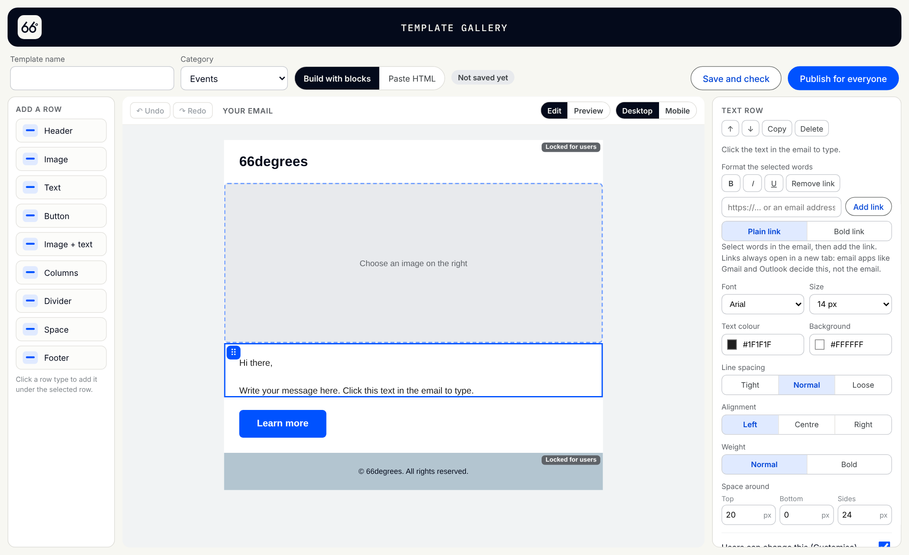
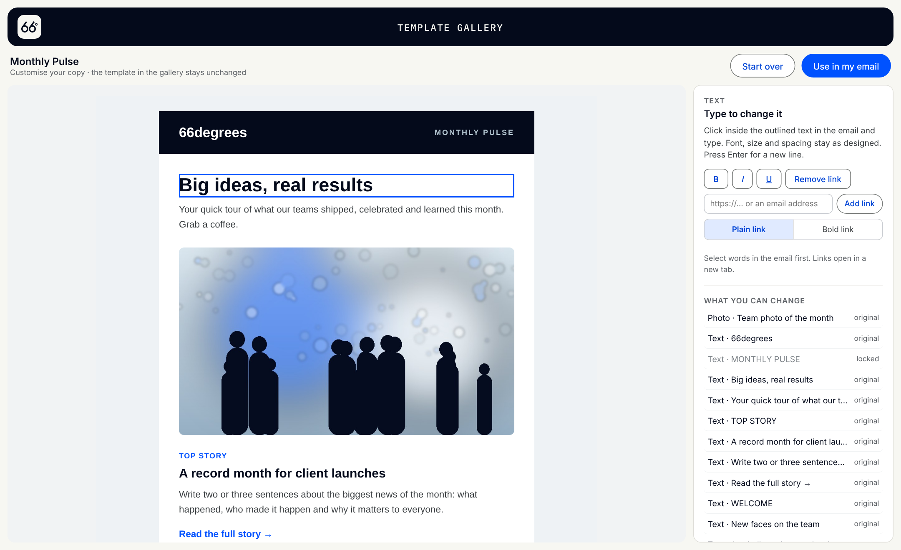
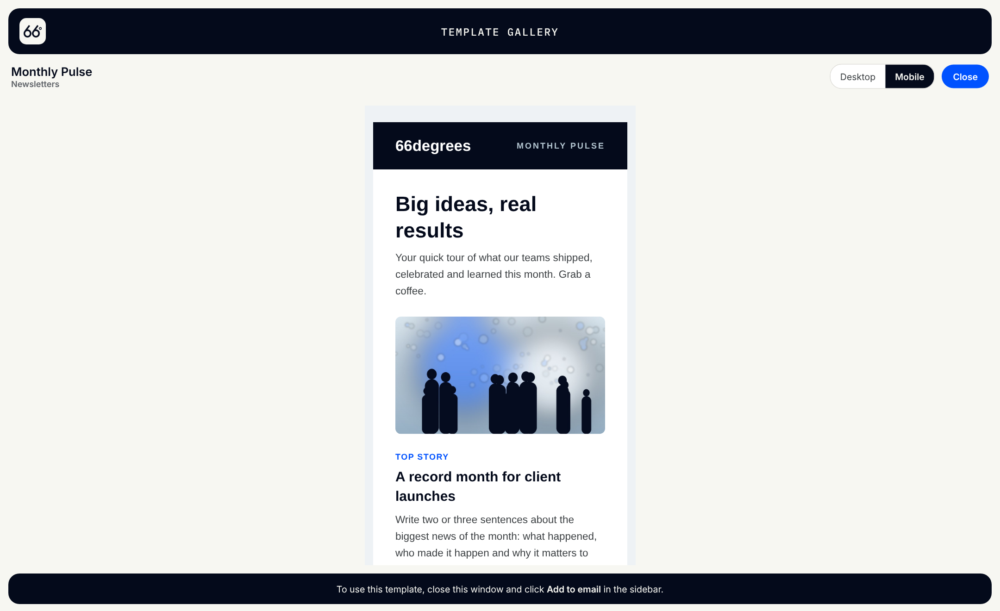
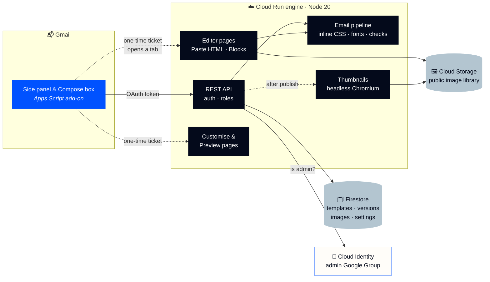

<p align="center">
  
</p>

<h1 align="center">66° Template Gallery – Gmail Template Builder</h1>

<p align="center">
  <b>On-brand HTML email templates for every 66er, right inside Gmail.</b><br>
  Marketing designs and locks. Everyone customises and sends.
</p>

<p align="center">
  
  
  
  
  
</p>

<p align="center">
  <a href="#-what-it-does">What it does</a> ·
  <a href="#-see-it">See it</a> ·
  <a href="#-how-it-works">How it works</a> ·
  <a href="#-quick-start">Quick start</a> ·
  <a href="#-brand-settings">Brand</a> ·
  <a href="#-what-it-costs">Costs</a> ·
  <a href="#-credits">Credits</a>
</p>

---

## ✨ What it does

66degrees designs its emails in Figma, Canva or with AI. Getting them into everyone's Gmail used to mean a marketing tool or copy-paste that broke the layout. **66° Template Gallery** is a **Gmail add-on with a small Google Cloud engine** that replaces that:

- 🎨 **The marketing team builds templates** by pasting HTML (from Figma plugins, Gemini, ChatGPT or Claude) or by **building with blocks**, then **locks** the parts that must stay on-brand and **publishes** to the company.
- ✍️ **Every 66er** opens the side panel in Gmail, picks a template, **changes only what's allowed** (photos, text) and clicks **Add to email**.
- ✅ **Every template is made Gmail-safe automatically:** CSS is inlined, fonts get safe backups, widths become fluid, and a checklist warns about anything Gmail would break.

### For template admins

| | |
|---|---|
| 🧩 **Two ways to build** | **Paste HTML** with *Edit in preview*, or **Build with blocks** (header, image, text, button, image + text, columns, divider, space, footer) |
| 🖱️ **Edit in preview** | Click any text, button, picture or row: fonts (39), sizes 10–72, colours, alignment, links, button styles |
| 🧱 **Rows** | Add, drag, move, copy, delete, set background and spacing; add the **66degrees header** or **footer** row in one click |
| 🔒 **Locks** | Lock any part or a whole row; users can't change it when customising |
| 🖼️ **Image library** | Upload (up to **1 MB**), pick, **copy into library** from other sites, cut to shapes (1:1, 4:5, 16:9…), see where each image is used, delete safely |
| 🪄 **Image reducer** | Too-big image? A red message offers **Reduce it here**: a built-in page that makes a copy under 1 MB right in the browser (or use Google Squoosh) |
| 🤝 **Share with people** | Give a draft to named colleagues only; it shows under **Shared with you** for them and nobody else |
| ↩️ **Undo, redo & versions** | Last 50 changes, `Cmd + Z`; every publish is kept and can be **restored** |
| 👥 **Teamwork** | Make a copy, categories (rename, delete), a warning when two admins save the same template |
| 🎯 **Who sees what** | Make **Teams** (named lists of people) and give each category to everyone, or only to chosen teams and single email addresses. New categories start as admins only |
| 🙈 **Hidden switch** | Hide any template (published, draft or shared) from users and the people it's shared with. Admins always see it, under a **Hidden** filter |
| ⚡ **Fast publish** | Live in a few seconds; the gallery thumbnail is made in the background |
| 🔗 **Link count** | The Gmail check tells you how many links a template has (information only) |

### For every 66er

| | |
|---|---|
| 📚 **Gallery** | Category chips and thumbnails in Gmail's side panel and Compose box |
| 🤝 **Shared with you** | Templates an admin shared with you by name, shown first |
| 👀 **Preview** | Desktop and mobile |
| ✏️ **Customise** | Retype text, swap photos (always fitted to the frame), bold / italic / links, with locked parts protected |
| 📨 **Add to email** | Opens a new email, or fills the one you're writing |

---

## 👀 See it

<table>
  <tr>
    <td width="50%"><br><sub><b>Edit in preview:</b> click text for font, size, colour, alignment and links. Row tools sit on the left.</sub></td>
    <td width="50%"><br><sub><b>Add a row:</b> text, image, button, columns, the 66degrees header or footer, or copy a row to keep your exact design.</sub></td>
  </tr>
  <tr>
    <td><br><sub><b>Image tools:</b> upload, library, copy into library, heights and alt text.</sub></td>
    <td><br><sub><b>Build with blocks:</b> rows, fonts, sizes, colours, spacing and locks, with no code.</sub></td>
  </tr>
  <tr>
    <td><br><sub><b>Customise:</b> 66ers change only what the admin allowed.</sub></td>
    <td><br><sub><b>Preview:</b> check desktop and mobile before sending.</sub></td>
  </tr>
</table>

<sub>Screenshots use stand-in pictures.</sub>

---

## 🧠 How it works



- The **add-on** (Apps Script, CardService) is the Gmail side panel. It calls the engine with the person's Google sign-in token.
- The **engine** (Node 20 on Cloud Run) checks the token, the 66degrees domain and the admin group, stores everything in **Firestore**, keeps pictures in a public **Cloud Storage** bucket, and serves the editor, customise and preview pages through **one-time tickets**.
- The **pipeline** turns any pasted or built email into Gmail-safe HTML and explains every change it made.

Read more in **[docs/architecture.md](docs/architecture.md)**.

---

## 🚀 Quick start

You need the 66degrees Google Workspace and a Google Cloud project with billing.

```bash
git clone https://github.com/eneelkant/66degrees-gmail-template-builder.git
cd 66degrees-gmail-template-builder/engine
cp env.example.yaml env.yaml        # fill in the project, bucket and admin group
npm ci && npm test                  # optional: run the tests locally

gcloud run deploy templates-backend --source . --region us-central1 \
  --service-account templates-backend@YOUR_PROJECT.iam.gserviceaccount.com \
  --allow-unauthenticated --env-vars-file env.yaml \
  --memory 2Gi --cpu 1 --max-instances 3 --timeout 60 --cpu-boost
```

Then paste `addon/Code.gs` and `addon/appsscript.json` into an Apps Script project, put the engine's URL in both, and install it as a test deployment.

📘 **Full step-by-step guide:** [docs/setup.md](docs/setup.md)

---

## 🎨 Brand settings

The 66degrees brand is the default. Everything can still be changed in `engine/env.yaml`, so sub-brands or events can have their own look:

| Setting | What it changes | 66degrees default |
|---|---|---|
| `APP_NAME` | Name on every page | `66° Template Gallery` |
| `BRAND_NAME` | Text in new header and footer rows | `66degrees` |
| `BRAND_WEBSITE` | Default link for new buttons | `https://www.66degrees.com` |
| `BRAND_LOGO_URL` | Logo in the top band | `/assets/logo-mark.png` (66° mark) |
| `BRAND_INK` | Night Blue: top band, text, header rows |  |
| `BRAND_ACCENT` | 66° Blue: buttons, links, selection |  |
| `BRAND_SOFT` | Shark Grey: footer rows |  |
| `BRAND_PAGE` | Page background |  |

Fonts: Gmail can't load web fonts, so templates use **Arial**. The brand font, Plus Jakarta Sans, is in the font list with Arial as its backup.

---

## 💰 What it costs

**No AI, no API keys, no tokens.** It runs on our own Google Cloud project, on services with free monthly allowances.

| | 🟢 50 people | 🔵 500 people | 🟣 5,000 people |
|---|---|---|---|
| **Per week** | ≈ $0.05 | ≈ $0.15 | ≈ $1.20 |
| **Per month** | ≈ $0.22 | ≈ $0.65 | ≈ $5.15 |
| **Per year** | ≈ $2.60 | ≈ $7.80 | ≈ $62 |

Most of the cost is pictures loaded when people open the emails. Full breakdown, a 2-minute way to calculate your own cost, and tips to keep it near $0: **[docs/costs.md](docs/costs.md)**.

---

## 🗂️ Project structure

```
.
├── addon/                  Gmail add-on (Google Apps Script)
│   ├── Code.gs             side panel, compose box, admin cards
│   └── appsscript.json     add-on manifest
├── engine/                 Cloud Run engine (Node 20, Express)
│   ├── src/
│   │   ├── server.js       routes, Firestore, Cloud Storage, versions, tickets
│   │   ├── auth.js         token check, domain, admin group
│   │   ├── pipeline.js     Gmail-safe HTML: inline CSS, fonts, widths, checks
│   │   ├── blocks.js       finds the editable parts; locks
│   │   ├── theme.js        brand settings (66degrees defaults)
│   │   ├── editorPage.js   the editor tab
│   │   ├── builder.client.js   Build with blocks
│   │   ├── htmledit.client.js  Paste HTML: edit in preview, rows, undo
│   │   ├── customisePage.js    what 66ers see when customising
│   │   ├── styles/         editor, customise, preview and upload CSS
│   │   └── …
│   ├── assets/             66° icon, logo and placeholders
│   ├── test/               node:test unit tests
│   ├── Dockerfile
│   └── env.example.yaml
├── examples/templates/     event, newsletter, HR and announcement templates
└── docs/                   setup, architecture, costs, guides, images
```

---

## 📏 Good to know

Gmail decides a lot about how emails look. The engine tells you when something will change instead of letting it break silently.

- **Web fonts don't load in Gmail.** Every font has a backup (usually Arial), and the check says which one people will see.
- **Mobile `@media` rules are removed by Gmail.** Widths are made fluid instead, so emails still fit phones.
- **Text inside pictures can't be edited.** Use real text for titles you want people to change.
- **Merge tags** like `{{Recipient.FirstName}}` from Salesforce aren't filled in by Gmail. The check warns you about them.
- **Logos with a see-through background** can disappear in Gmail's dark mode. Export them on white.
- **Over 102 KB, Gmail cuts the email.** The check shows the size and stops you at the limit.
- **Images are limited to 1 MB** so emails load fast. The built-in image reducer makes a smaller copy in one step.
- **Gmail decides the add-on panel's font and sizes.** The panel uses Gmail's own building blocks; the editor and other pages are fully styled.
- The add-on runs in **Gmail on the web**. Gmail's phone apps don't show add-on side panels, but emails sent with it look right everywhere.

---

## 🤝 Contributing

Ideas, bug reports and pull requests are welcome. Start with **[CONTRIBUTING.md](CONTRIBUTING.md)**, and please report security problems privately as described in **[SECURITY.md](SECURITY.md)**.

---

## 💜 Credits

| | Who | Role |
|---|---|---|
| 🎨 | **Legends** ([@nexoradev-stack](https://github.com/nexoradev-stack)) | Product, design, testing and direction |
| 🧭 | **Neel** ([@eneelkant](https://github.com/eneelkant)) | Co-owner, Google Cloud and repository |
| 🤖 | **Claude** (Anthropic) | Code, architecture and docs, pair-built with Legends |
| ⌨️ | **Cursor** | AI code editor used in the build |

A brand-free version for any company: [Custom Email Template Builder – Gmail](https://github.com/nexoradev-stack/Custom-Email-Template-Builder-Gmail).

---

## 📄 Licence

[Apache License 2.0](LICENSE).
